<p align="center">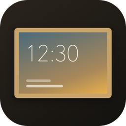</p>

<h1 align="center">Frame Canvas</h1>

<p align="center"><b>Turn Art Mode on your Samsung The Frame into a calm, beautiful, living dashboard.</b></p>

<p align="center">
  <a href="https://my.home-assistant.io/redirect/supervisor_add_addon_repository/?repository_url=https%3A%2F%2Fgithub.com%2Fsparkensparken%2Fframe-canvas"></a>
</p>
<p align="center">
  <a href="https://github.com/sparkensparken/frame-canvas/releases"></a>
  
  
  <a href="LICENSE"></a>
</p>

Frame Canvas is a Home Assistant add-on that renders a 4K dashboard – clock, date, weather,
your calendars, camera snapshots, a news ticker and gorgeous background photography – and
shows it *as art* on The Frame. It refreshes every minute, keeps Art Mode's low-power, matte
look, and lets your Home Assistant sensors turn the TV on when you walk in and off when you leave.

<p align="center">
  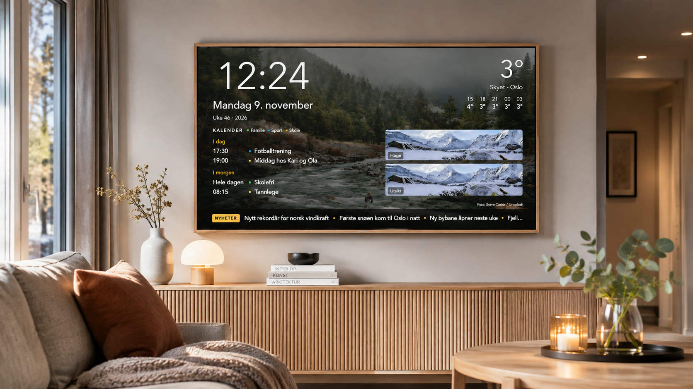
</p>

<table>
  <tr>
    <td width="33%">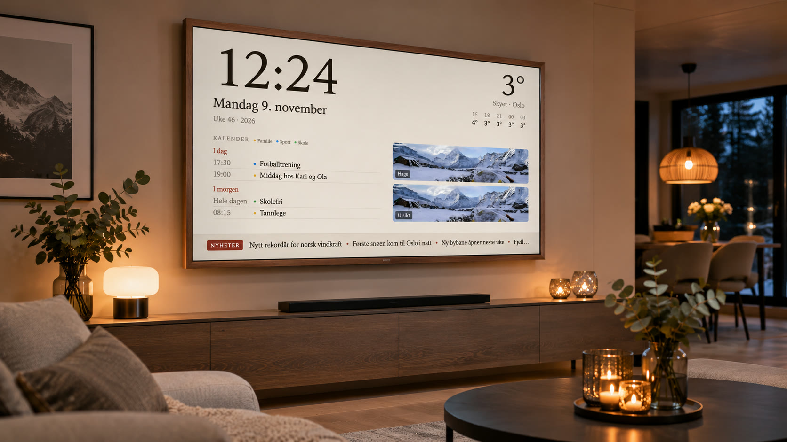</td>
    <td width="33%">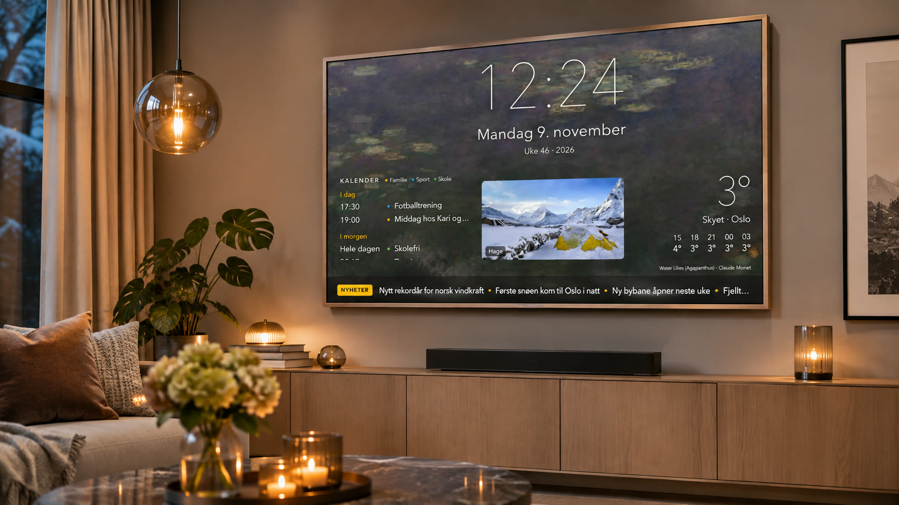</td>
    <td width="33%">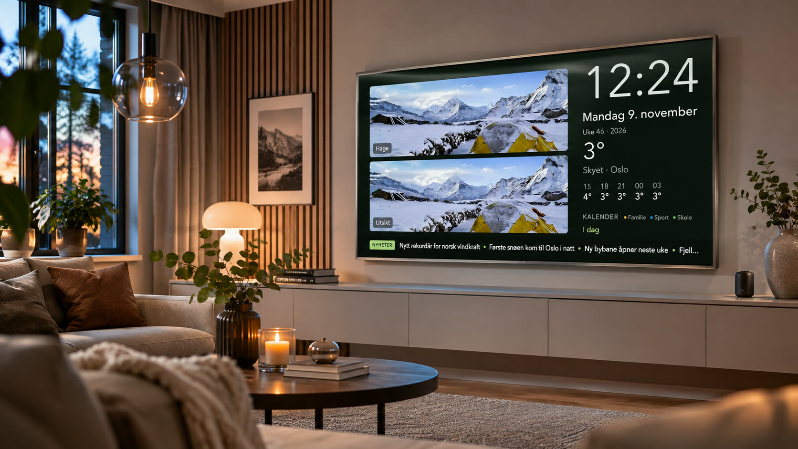</td>
  </tr>
</table>

<p align="center"><sub>Illustrative mockups (AI-generated rooms with real Frame Canvas screenshots, Norwegian UI). Real screenshots below.</sub></p>

---

## Why?

The Frame is a great TV that pretends to be a painting. But a painting can't tell you that it's
going to rain at three, that football practice starts at half past five, or who's at the front door.
Frame Canvas keeps the art – and quietly adds the information you actually glance at.

No apps to sideload, no browser kiosk, no developer mode. It uses The Frame's own Art Mode,
so the TV's light sensor, matte display and power-saving behave exactly as Samsung intended.

## Features

| | |
|---|---|
| 🕰️ **Clock, date & week number** | Large, legible typography in four layouts |
| 🌦️ **Weather** | Free forecasts from MET Norway – worldwide, no API key |
| 📅 **Calendars** | Add any iCal link (Google, iCloud, Outlook). Colour per person, show/hide, reorder |
| 📷 **Cameras** | Picks up your Home Assistant cameras automatically – up to four snapshots |
| 📰 **News ticker** | Headlines from RSS feeds, slowly rotating like a ticker |
| 🖼️ **Background art** | Modern photography (Unsplash), Bing's photo of the day (4K) or public-domain paintings from the Cleveland Museum of Art – only wide images that fill the screen |
| 🎨 **Appearance** | Five themes, accent colours, two typefaces, thin/regular/bold weights, clock size |
| 🚶 **Presence control** | Use presence/motion sensors or your phone: TV on when you arrive, off when the room has been empty |
| 📻 **Radio** | One-tap internet radio to your Home Assistant speakers (or the TV) |
| 🔆 **TV settings** | Art Mode brightness, colour temperature, light sensor and motion timer from one place |
| 🌍 **English & Norwegian** | Follows your Home Assistant language, or pick one |
| 🛡️ **Gentle on the panel** | Subtle pixel shift every minute and rotating backgrounds |

## Gallery

<p align="center">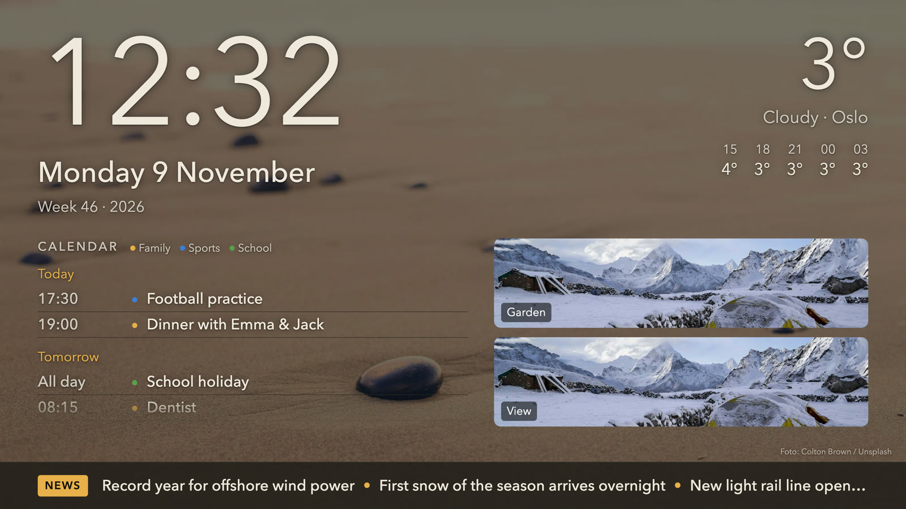</p>
<p align="center"><sub><i>Classic layout · photo background · cameras · news ticker</i></sub></p>

| | |
|---|---|
| 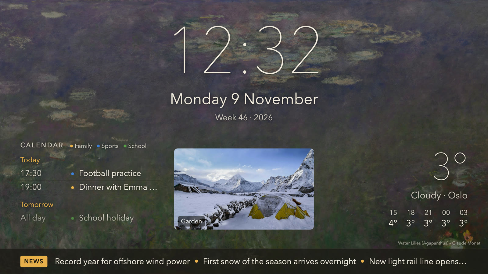 | 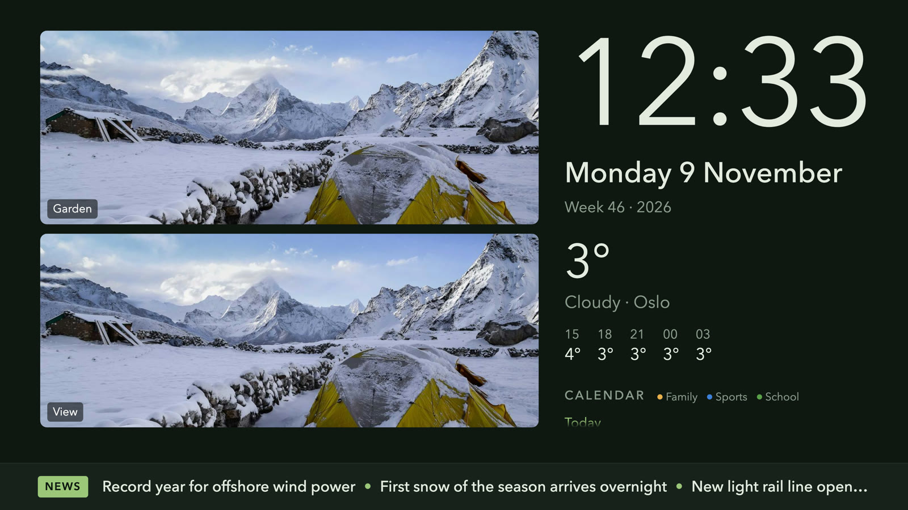 |
| *Centred clock · paintings* | *Large camera · forest theme* |
| 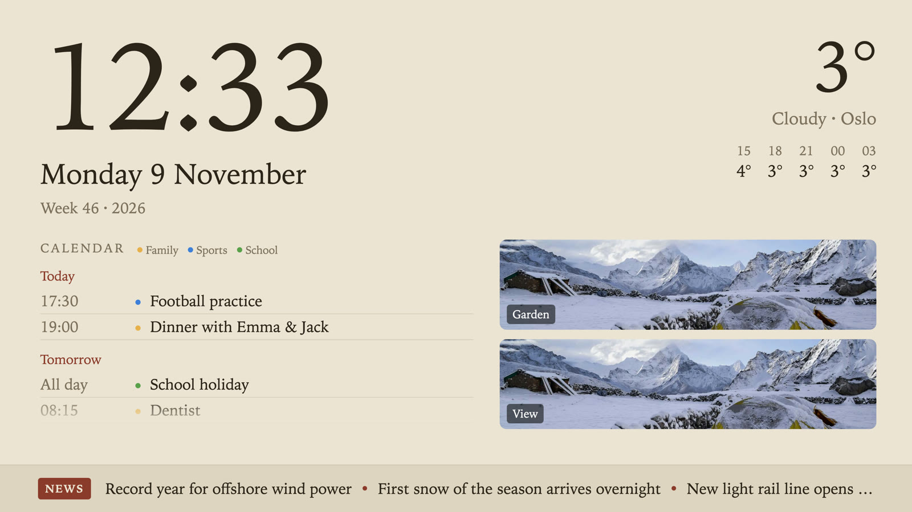 | 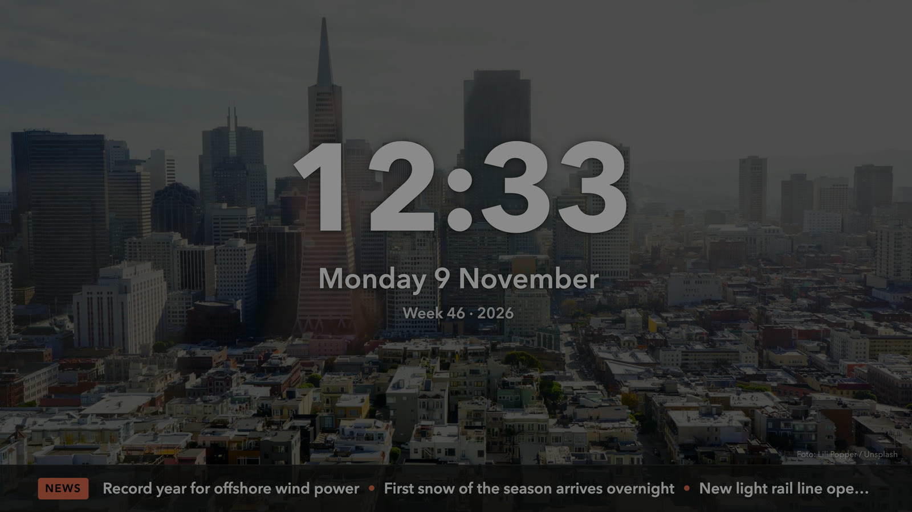 |
| *Paper theme · serif* | *Minimal · night theme · bold* |

### Control panel

Everything is configured from a panel in the Home Assistant sidebar – with a live preview.

<p align="center">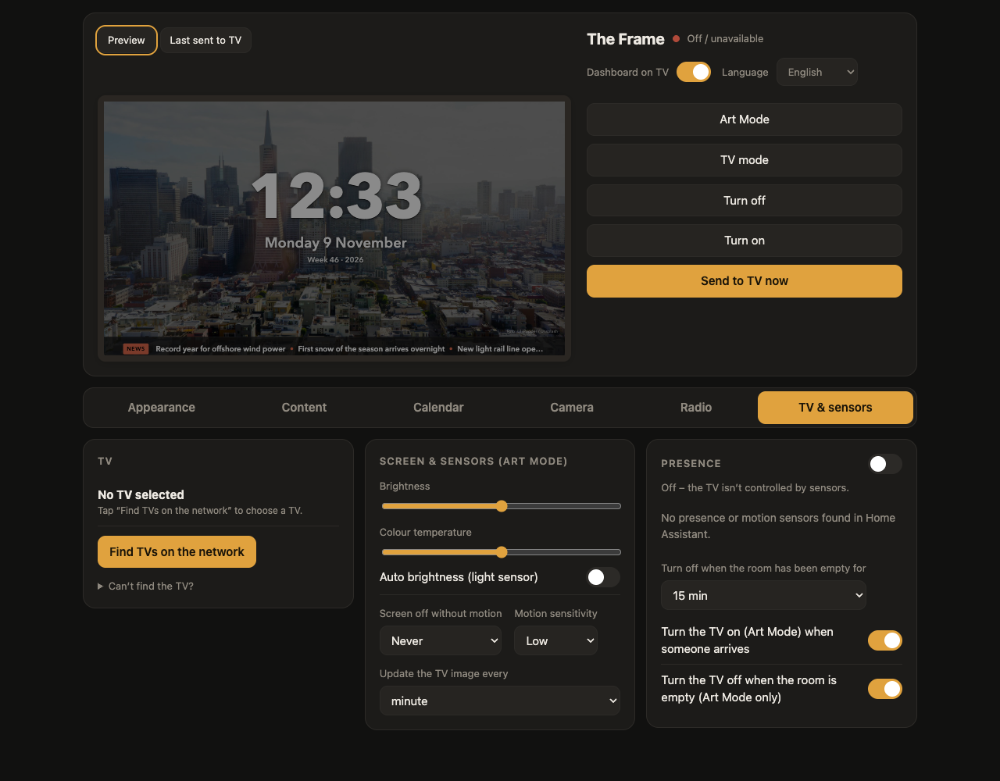</p>

## Installation

**One click:** press the **Add repository** button at the top of this page, then skip to step 3.

**Manually:**

1. In Home Assistant, go to **Settings → Apps (Add-ons) → App store**.
2. Open the **⋮** menu → **Repositories**, paste
   ```
   https://github.com/sparkensparken/frame-canvas
   ```
   and click **Add**.
3. Find **Frame Canvas** in the store → **Install**. It builds locally (5–10 minutes on a Home Assistant Green).
4. **Start** it and enable **Show in sidebar**.
5. Open **Frame Canvas** in the sidebar → **TV & sensors** → **Find TVs on the network** → **Select**.
6. Accept the connection prompt on the TV the first time.

That's it – the dashboard appears in Art Mode within a minute.

## Recommended TV settings

- **Night Mode → Off** (Art Mode → *Art Mode Options* → *Sleep Options*). Otherwise The Frame
  switches itself off in a dim room about a minute after turning on.
- **Power On with Mobile → On** (*Settings → General & Privacy → Network → Expert Settings*),
  so the TV can be woken over the network.
- Turn off any Art Mode slideshow so the TV doesn't rotate away from the dashboard.

## Requirements

- Samsung **The Frame** (tested on the 2025 LS03F; 2021+ models with the Art Mode API should work)
- **Home Assistant OS** or Supervised (Green, Yellow, Raspberry Pi 4/5, x86-64)
- TV and Home Assistant on the same local network

## How it works

1. A small web server renders the dashboard page with your settings.
2. Headless Chromium takes a 3840 × 2160 snapshot.
3. The image is uploaded to The Frame's Art Mode over the local network and selected;
   the previous one is deleted, so nothing piles up on the TV.
4. Nothing is pushed while the TV is in standby – so it never wakes the TV by accident.

Everything runs locally. The add-on only reaches out for weather, news, background images
and the calendars you add.

## Automations

Frame Canvas exposes a small local API on port `8765`, so you can drive it from automations –
for example a dimmer, minimal "night" look at 22:00:

```yaml
rest_command:
  frame_canvas_settings:
    url: http://127.0.0.1:8765/api/settings
    method: POST
    content_type: application/json
    payload: "{{ settings | tojson }}"

automation:
  - alias: "Frame Canvas – night look"
    triggers: [{ trigger: time, at: "22:00:00" }]
    actions:
      - action: rest_command.frame_canvas_settings
        data: { settings: { theme: natt, layout: minimal, show: { news: false } } }
```

A complete example package (status sensors, scripts, radio) is included in
[`frame_canvas/frame_tv.yaml`](frame_canvas/frame_tv.yaml).

## FAQ

**Can I watch the cameras live?** Art Mode only shows still images, so cameras refresh once a minute.

**Will it burn in?** The Frame is a QLED (LCD) panel, which doesn't suffer permanent burn-in like OLED.
Frame Canvas still shifts the layout by a few pixels every minute and rotates backgrounds.

**Can radio play while Art Mode is on?** Not on the TV itself – Samsung stops media playback in Art Mode.
Pick a Home Assistant speaker (e.g. a Chromecast or Sonos) instead and the TV stays in Art Mode.

**The TV keeps turning itself off.** Check *Night Mode* and *Sleep After* in the Art Mode options.

## Credits

- Weather: [MET Norway](https://api.met.no/) · Place search: [Open-Meteo](https://open-meteo.com/)
- Photography: [Unsplash](https://unsplash.com/) via [Lorem Picsum](https://picsum.photos/) ·
  Photo of the day: Bing · Paintings: [Cleveland Museum of Art Open Access](https://openaccess-api.clevelandart.org/) (CC0)
- TV control: [samsung-tv-ws-api](https://github.com/xchwarze/samsung-tv-ws-api)

Screenshots use demo data.

## Disclaimer

Frame Canvas is an independent hobby project and is not affiliated with, endorsed by or
sponsored by Samsung. "The Frame" and "Art Mode" are trademarks of Samsung Electronics.

## License

[MIT](LICENSE)
